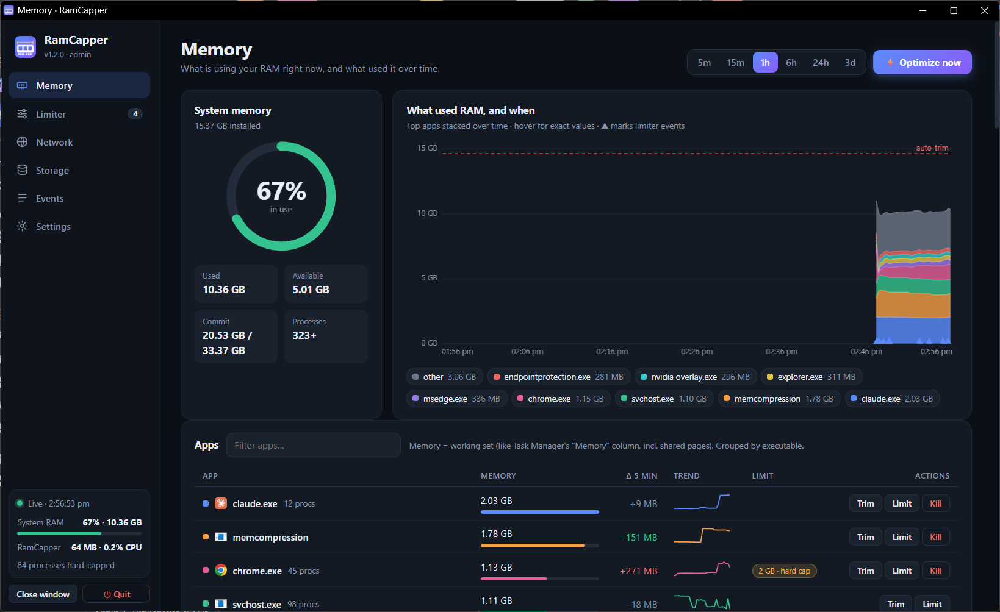

<p align="center">
  
</p>

<h1 align="center">RamCapper</h1>

<p align="center">
  A lightweight Windows RAM monitor with per-app limits, plus network and disk-usage tools.<br>
  See <b>what</b> is eating your memory, <b>when</b> it happened, and cap it.
</p>



## Features

### Memory
- **Live dashboard** – system gauge plus a stacked timeline of the top apps (5 min → 3 days). Hover for exact values at any moment; limiter actions are marked on the timeline.
- **Per-app view** – processes grouped by executable with icons, trend sparklines, 5-minute change and per-process drill-down. **Optimize now** trims idle memory from every reachable process.
- **Limiter** – set a limit per app (all its processes combined) with one of four actions:
  | Action | What it does |
  |---|---|
  | **Alert** | Logs an event and shows a toast. |
  | **Trim** | Returns the app's idle memory to Windows (safe, app keeps running). |
  | **Hard cap** | Windows enforces a working-set ceiling per process (limit ÷ process count). The app pages instead of growing; no crash. |
  | **Terminate** | Ends the app after it stays over its limit for N checks (2 s each). |
- **Emergency auto-trim** – trims every reachable process when system RAM crosses a threshold you choose.
- **Kill** – end an app (all its processes) straight from the app list.

### Network *(opt-in)*
- **Per-app bandwidth** – real-time download/upload per app (TCP and UDP) with session totals, sorted busiest-first. Uses Windows ETW, which requires administrator rights.
- **Connections** – live connections per app, throughput chart, and an **End** button per connection's process.
- **Device discovery** – scans your local subnet and alerts on new devices. Devices are identified by hostname (NetBIOS, mDNS, router DNS), UPnP description, a MAC-vendor database and a light port fingerprint (router, printer, Chromecast, IoT…). Click ✎ to give any device your own name.
- **Network limits** – per-app **Throttle upload** (Windows QoS) or **Block internet** (Windows Firewall rule), plus **Kill**. Limits need administrator rights; download speed can't be limited natively by Windows.

### GPU
- **GPU tab** – every graphics card (NVIDIA, AMD, Intel) with live utilization, a 5-minute history chart, video-memory use and engine breakdown (3D, Copy, Video…), plus a table showing **how much of each card every app is using** (usage and VRAM per card). Same sortable / hideable columns. No admin needed.

### Storage *(opt-in)*
- Scan a drive or folder to see what takes the most space: drill-down folders, largest files, breakdown by file type. Read-only.

### App experience
- **One page per tab** – sidebar navigation with separate pages for Memory, Limiter, Network, Storage, Events and Settings; live system RAM and RamCapper's own resource use are always visible in the sidebar.
- **Sortable tables with hideable columns** – click a header to sort; the ⋮ menu in a table's last header shows or hides columns (Odoo-style). Your choices are remembered.
- **Notch stats bar** – a one-line notch that slides down from the top edge of the screen when you minimize the dashboard: RAM % with a live sparkline and used/total, total CPU, GPU usage, live download and upload speed (with icons) and your biggest app. It flashes limiter actions, pulses red when memory is critical, restores the dashboard on click and has a right-click menu. Choose when it shows (minimized / whenever the window is hidden / always / off) in Settings. Set its opacity, and choose whether it stays visible or **pops out only when the mouse reaches the screen edge** it sits on. Place it on the bottom (just above the taskbar, the default), top, left or right edge – the side positions switch to a vertical dock layout with progress bars.
- **Tray icon** – RamCapper keeps running when you close its window; the notification-area icon opens the dashboard (click) or quits (right-click). Start with `--no-tray` to disable it.
- **Close window vs. Quit** – *Close window* only closes the dashboard (monitoring and limits keep running); *Quit* exits completely.
- **Single instance** – starting RamCapper again, or clicking the tray icon, focuses the open window instead of opening another. A newer version automatically replaces an older one that is still running. (Task Manager shows two `RamCapper.exe` entries for the one-file build – that is PyInstaller's launcher plus the app, not two copies.)
- **Shortcuts** – add RamCapper to the Start menu or desktop from **Settings**, then pin it to the taskbar from there (Windows does not let apps pin themselves).
- **Administrator mode** – restart elevated from the app (UAC prompt) to manage elevated/system processes, see per-app bandwidth and create network limits.
- **Optional installer (like AnyDesk)** – the portable `.exe` works as-is, and **Settings → Install RamCapper** can also install it to `C:\Program Files\RamCapper` with a Start menu entry, optional desktop shortcut and auto-start, plus an "Apps & features" uninstall entry. Your history moves with it (installed copies keep data in `%APPDATA%\RamCapper`). **Uninstall** removes everything and can keep or delete your data.
- **Portable** – single `.exe`, no installer. History and settings live in a folder you choose, which can be moved from Settings.
- **Safe by design** – clipboard owners are never trimmed, critical Windows processes can't be ended, and the web UI only listens on `127.0.0.1`.

## Quick start

### Download
Grab `RamCapper.exe` from the [Releases](../../releases) page and run it. A window opens; the app keeps running in the background (tray icon) until you press **Quit**.

> The executable is not code-signed, so Windows SmartScreen may warn on first run ("More info → Run anyway"). Some antivirus products flag PyInstaller binaries; building from source (below) avoids that.

### Run from source
Requires Windows 10/11 and Python 3.9+.

```bash
git clone https://github.com/tekno-lab/ramcapper.git
cd ramcapper
pip install -r requirements.txt
python ramcapper.py
```

## How to compile

The portable executable is built with [PyInstaller](https://pyinstaller.org). The dashboard (`web/`) and icon are bundled into the single file.

**Prerequisites:** Windows 10/11 · Python 3.9+ on `PATH` · internet access for `pip`.

### One command

```bat
build.bat
```

This installs the dependencies and runs PyInstaller. The result is **`dist\RamCapper.exe`** (≈ 9 MB).

### Manual build

```bash
pip install -r requirements.txt pyinstaller
python -m PyInstaller --noconfirm --clean --onefile --noconsole ^
    --icon assets\ramcapper.ico --name RamCapper ^
    --add-data "web;web" --add-data "assets\oui.json.gz;assets" ramcapper.py
```

Flag notes: `--onefile` produces the portable exe, `--noconsole` hides the console window, `--add-data` bundles the UI (`web/`) and the MAC-vendor database next to the code (Windows uses `;` as the separator).

### Troubleshooting the build

| Problem | Fix |
|---|---|
| `Unable to find ... index.html when adding binary and data files` | Run the command from the repository root (the folder containing `web/`). |
| `ValueError: path is on mount 'D:', start on mount 'C:'` | Don't point `--workpath` / `--specpath` at a different drive than the project. The defaults are fine. |
| Antivirus quarantines `dist\RamCapper.exe` | Common false positive for PyInstaller one-file apps. Add an exclusion or run from source. |
| Replacing a running exe fails | Press **Quit** in RamCapper (or run `kill.bat`) first. |

### Regenerating the icon (optional)

The icon source is `assets/icon.svg`. To rebuild `assets/ramcapper.ico` and `assets/icon.png` (needs `pip install pillow` and Microsoft Edge):

```bash
python tools/make_icon.py
```

## Usage

| Command | Effect |
|---|---|
| `RamCapper.exe` | Start (or just show the window if already running). |
| `RamCapper.exe --admin` | Relaunch elevated (UAC prompt). Needed to trim, cap or end elevated/system processes. |
| `RamCapper.exe --data "E:\RamCapperData"` | Use a specific data folder. |
| `RamCapper.exe --no-open` | Run in the background without opening a window. |
| `RamCapper.exe --no-tray` | Don't show the notification-area icon. |
| `RamCapper.exe --install` | Install to Program Files (UAC prompt). Add `--no-desktop`, `--no-startup` to skip those. |
| `RamCapper.exe --uninstall` | Remove an installed copy (also used by Windows' "Apps & features"). `--purge` deletes history and settings. |

You can also restart as administrator and move the data folder from the **Settings** tab.

`run.bat`, `run_admin.bat` and `kill.bat` are convenience launchers for the source version (`kill.bat` also stops the exe).

### Data location

`history.db` (3 days of memory history, events, known devices) and `config.json` (limits and switches) are stored, in order of priority:

1. `--data DIR`
2. `RAMCAPPER_DATA` environment variable
3. the folder saved from **Settings** (pointer in `datadir.txt` next to the exe, or `%APPDATA%\RamCapper`)
4. next to the program

`RAMCAPPER_PORT` changes the local port (default `8765`).

## How it works

- A sampler thread reads per-process memory with [psutil](https://github.com/giampaolo/psutil) every 2 s and stores the top apps in SQLite every 5 s.
- A tiny `http.server` on `127.0.0.1` serves the single-page dashboard and a JSON API. State-changing calls require a custom header and a matching `Host`, which blocks cross-site and DNS-rebinding requests.
- Trimming uses `EmptyWorkingSet`; hard caps use `SetProcessWorkingSetSizeEx` with the hard-max flag; both are skipped for clipboard-related processes.
- Memory shown is the **working set** (like Task Manager's "Memory" column, including shared pages), so a trim is visible immediately.

## Limitations

- Windows only.
- Per-app bandwidth needs administrator rights (it uses an ETW trace); without them only whole-machine throughput and connection counts are shown.
- Without administrator rights, protected and elevated processes can't be trimmed, capped or ended.
- Local-network discovery is a ping sweep of your own `/24` plus the ARP table, so devices that block ping and haven't talked to you recently may not appear.

## Project layout

```
ramcapper.py      backend: sampler, limiter, network/storage modules, HTTP server
web/              dashboard: one page per tab (index, limiter, network, storage, events, settings) + shared app.css / app.js
assets/           icon source (SVG), .ico and .png, MAC-vendor database (oui.json.gz)
tools/            helper scripts (icon generation, make_oui.py to refresh the vendor database from the IEEE registry)
build.bat         one-command PyInstaller build
run*.bat kill.bat launchers for the source version
```

## Antivirus warnings

`RamCapper.exe` is an **unsigned** program packaged with PyInstaller, and unsigned PyInstaller executables are a common source of antivirus *false positives*. RamCapper also does things monitoring tools legitimately do (trim and end other processes, read per-process network/GPU counters, optionally scan your LAN or add firewall rules), which some heuristics dislike. What it does to stay out of the way:

- **Nothing is persistent unless you choose it.** "Start with Windows" and the installer are opt-in; auto-start is a normal shortcut in your Startup folder (no Run-registry entry), and it can be removed in Settings.
- No UPX compression, no scripts with `ExecutionPolicy Bypass`, no hidden-window tricks, no simulated key presses; shortcuts are created with the Windows shell API.
- The web UI only listens on `127.0.0.1`, and nothing is sent anywhere (no telemetry, no update checks).
- The exe has proper file properties (company, description, version) and every release lists its SHA-256.

If your antivirus still complains: check the SHA-256 in the release notes matches your download, read or build the source yourself (see *How to compile*), add an exclusion for the exe, and – best of all – report it as a false positive to your vendor (most have a web form). A code-signing certificate is the real long-term fix and is on the wishlist.

## License

RamCapper is **source-available, free for non-commercial use**, under the [PolyForm Noncommercial License 1.0.0](LICENSE).

You may use, modify and share it for personal use, learning, research, hobby projects, and non-profit/educational/government organizations. **Commercial use is not permitted** (including use inside a for-profit business, or bundling it into a paid product or service). For a commercial license, please open an issue or contact the author.

Note: because it restricts commercial use, this is not an OSI-approved "open source" license.
